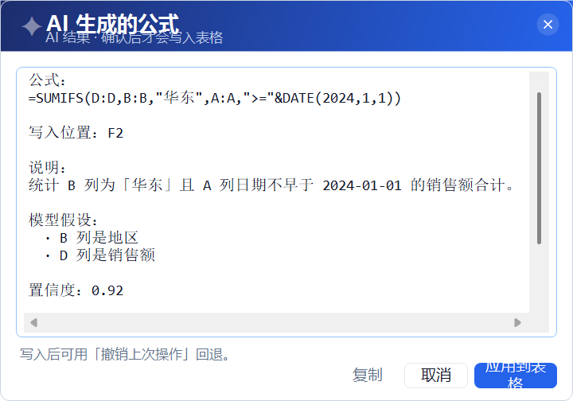

# EXCLE助手

> 独立实现的 Excel 效率插件 · **320 个功能** · 单 DLL · 零第三方依赖 · 纯本地运算

把常用表格操作集中起来的 Excel 加载项：文本清洗、数值与日期、行列编辑、格式美化、汇总拆分、
多表关联、数据质量检查、工作簿治理，外加一套可用的 AI 助手。
**全部功能免费 —— 没有会员、账户、联网校验或功能门禁。**


## 特性

- **320 个功能**，3 个选项卡 / 14 个功能组；功能区与可搜索面板双入口
- **单文件交付**：一个 `ExcleHelper.dll`，不需要 VSTO 运行时 / Office PIA / Aspose / 任何第三方库
- **所有操作可回退**：每次操作前自动快照（公式、值与格式），支持撤销、重做、多步历史；AI 写入同样可回退
- **数据整合**：多表 JOIN（左 / 内 / 右 / 全）、按主键刷新、记录级合并、列名对齐追加、一键透视表、交叉表
- **数据质量**：异常值检测、缺失值六种策略、模糊重复、数据字典、单位统一、电话地址规范化、变更日志
- **AI 助手**：生成 / 解释 / 纠错公式、对话面板、智能填充、分类打标、字段提取、数据洞察、清洗建议、
  自然语言筛选、图表建议、数据字典、表格问答、分析报告、批量翻译
- **自带图标与界面**：每个功能各有独立图形图标，全部代码绘制，无外部素材

## 快速开始

```powershell
# 安装（只写 HKCU，无需管理员）
powershell -ExecutionPolicy Bypass -File .\install.ps1

# 重启 Excel：功能区出现「EXCLE助手 / 格式与数据 / 工具与输出」三个选项卡
```

从源码构建（用系统自带的 .NET Framework 编译器，不需要 Visual Studio）：

```powershell
powershell -ExecutionPolicy Bypass -File .\build.ps1       # 产出 bin\ExcleHelper.dll
powershell -ExecutionPolicy Bypass -File .\install.ps1     # 注册到当前用户
powershell -ExecutionPolicy Bypass -File .\uninstall.ps1   # 反注册（先导出 .reg 备份）
```

仓库已附带构建好的 `bin/ExcleHelper.dll`，不想编译可直接运行 `install.ps1`。

## 界面

| 功能面板（可搜索，支持拼音首字母） | AI 助手 |
|---|---|
|  |  |

| AI 结果预览（先看后落盘） | AI 设置 |
|---|---|
|  |  |

## AI 配置

`工具与输出 → AI 助手 → AI 设置`：填接口地址、模型名与 API Key，点「测试连接」即可。

- 支持 **DeepSeek**、任何 **OpenAI 兼容接口**、自建网关，以及**本地模型**（Ollama 等，可完全离线）
- API Key 用 **DPAPI（当前用户作用域）** 加密存于 `%APPDATA%\ExcleHelper\ai.bin`，明文不落盘、不进日志
- 只发送**表格摘要**（表头 + 列类型 + 少量样本），默认开启发送前脱敏
- 模型只产出结构化指令：**公式会先在临时单元格试算**，校验通过并经你确认后才写入表格

## 文档

- [功能规划与交付](docs/功能规划与交付.md) —— 完整能力总览、交付批次、质量评审、测试体系、自动化接口
- [AI 功能设计](docs/AI功能设计.md) —— AI 模块的架构、安全边界与实现取舍

## 测试

9 套 UI 自动化回归、共 **103 项断言**，通过 UI Automation 真实点击功能区并校验单元格结果：

```powershell
powershell -ExecutionPolicy Bypass -File .\run-all.ps1   # 逐套运行，套间自动清理 Excel 状态
powershell -ExecutionPolicy Bypass -File .\ui-shot.ps1   # 只渲染设计稿（改界面时用）
```

AI 用例全部走**本地 mock 供应商**，无需外网与真实额度也能跑。

## 已知限制

- 身份证 / 银行卡等长数字请先把单元格设为**文本**格式，否则 Excel 会截断精度
- 合并、转置、随机排序等属于「取值重建」，不保留源格式；**拆分工作表 / 按列值拆分保留原格式**
- 合并多表按列位置对齐，不做字段名智能匹配
- 批量操作前建议先保存 —— 插件不接管 Excel 原生撤销栈，请用内置的「撤销上次操作」
- AI 功能需要自备 API Key，并会把所选区域的**摘要**发送到你配置的接口

## 许可

未声明许可证（默认保留所有权利）。如需开源使用，可自行添加 MIT / Apache-2.0。
